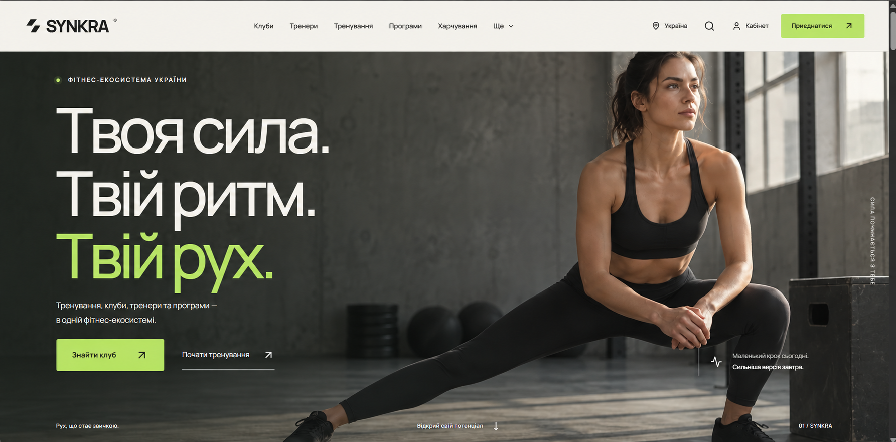

<div align="center">

# SYNKRA

### Рух, що стає звичкою.
**A fitness platform connecting personal training with club operations.**


[**Explore the project · English**](REVIEW.md#english) · [**Обзор и проверка · Русский**](REVIEW.md#русский) · [**Developer guide**](DEVELOPMENT.md)

</div>



## English

SYNKRA brings club discovery, workout planning, nutrition, bookings, and memberships into one Ukrainian fitness platform. A customer workspace and a staff dashboard share persistent server data, connecting the public website to CRM and administrative workflows.

### Explore the experience

| For the customer | For the team |
|---|---|
| Find and compare clubs on an interactive Ukraine map | Track inquiries and registration leads in CRM |
| Explore trainers, exercises, workouts, and programs | Manage clients, roles, and club access |
| Build workout plans and record completed sessions | Review orders, memberships, and bookings |
| Plan meals and generate a shopping list | Reply to support requests |
| Save favorites, track measurements, and book classes | Edit catalog content and review audit history |

### What makes the project worth exploring

- **Connected workflows:** registrations and inquiries become CRM leads; confirmed payments issue digital memberships and update the registration lead.
- **Persistent personal data:** plans, results, nutrition, favorites, and bookings remain available after a server restart.
- **Scheduled processing:** membership expiry, advance reminders, session cleanup, and queued message delivery are handled by server jobs.
- **Scoped administration:** managers work with assigned clubs; administrators control central operations and roles.
- **Payment integrity:** server-priced orders, signed callbacks, duplicate protection, refund handling, and QR membership verification.
- **Traceable assets:** catalog photographs have author, source, license, and checksum records; a local map works without a Google Maps key.

### Catalog at a glance

| Cities | Sample clubs | Sample trainers | Exercises | Workouts | Programs | Recipes |
|:---:|:---:|:---:|:---:|:---:|:---:|:---:|
| 100 | 250 | 60 | 300 | 120 | 40 | 150 |

### Run locally

Install **Node.js 24 LTS**, then run from the project folder:

```sh
npm ci
node scripts/init-local.mjs
node scripts/start-local.mjs
```

Open **http://127.0.0.1:5174/**. On Windows, `Start-SYNKRA.cmd` also handles setup and startup. Create your own test account; the author's private accounts and database are not included.

**Review in a few minutes:** browse clubs → register → save a favorite → build a workout → add a meal → inspect the administration panel using the [review guide](REVIEW.md#english).

### Implementation and validation

React 19 · TypeScript · Vinext/App Router · Cloudflare Workers · D1/SQLite · Drizzle · Zod.

On **October 14, 2026**, TypeScript and the production build passed, along with **157 backend assertions and 15 additional tests**. ESLint still has recorded issues; the detailed guide documents the validation limits.

**Project status:** locally reviewable portfolio application. Club and trainer seed records are illustrative. LiqPay, email, Telegram, and Google Sheets adapters require owner configuration; live provider acceptance testing is not claimed. Scheduled jobs require the deployed Worker trigger or an explicit authorized run.

---

## Русский

SYNKRA объединяет поиск клубов, тренировки, питание, записи на занятия и абонементы в одной фитнес-платформе с украинским интерфейсом. Кабинет клиента и панель команды работают с общей серверной базой, связывая сайт с CRM и управлением контентом.

### Что можно попробовать

| Для клиента | Для команды |
|---|---|
| Поиск и сравнение клубов на карте Украины | Обработка заявок и регистраций в CRM |
| Каталоги тренеров, упражнений, тренировок и программ | Управление клиентами, ролями и доступом к клубам |
| Создание планов и сохранение результатов тренировок | Просмотр заказов, абонементов и записей |
| Планирование питания и список покупок | Ответы на обращения поддержки |
| Избранное, замеры прогресса и запись на занятия | Редактирование каталогов и журнал аудита |

### На что обратить внимание

- **Связанные процессы:** регистрации и обращения создают заявки CRM; подтверждённая оплата выдаёт цифровой абонемент и обновляет регистрационную заявку.
- **Сохранение данных:** планы, результаты, питание, избранное и записи остаются после перезапуска сервера.
- **Автоматизация:** фоновые задания обрабатывают сроки абонементов, напоминания, очистку сессий и очередь сообщений.
- **Разделение доступа:** менеджеры работают с назначенными клубами, администраторы — с общими процессами и ролями.
- **Проверка платежей:** цена рассчитывается сервером, уведомления проверяются по подписи, повторная выдача блокируется, возврат отменяет абонемент; QR позволяет проверить его действительность.
- **Происхождение ресурсов:** у фотографий сохранены авторы, источники, лицензии и контрольные суммы; локальная карта работает без Google Maps.

В начальном каталоге: **100 городов, 250 примеров клубов, 60 примеров тренеров, 300 упражнений, 120 тренировок, 40 программ и 150 рецептов**.

### Запуск и проверка

Установите **Node.js 24 LTS** и выполните из папки проекта:

```sh
npm ci
node scripts/init-local.mjs
node scripts/start-local.mjs
```

Откройте **http://127.0.0.1:5174/**. На Windows можно запустить `Start-SYNKRA.cmd`, который подготовит проект автоматически. Создайте свой тестовый аккаунт: личная база и аккаунты автора не входят в репозиторий.

**Маршрут знакомства:** каталог клубов → регистрация → избранное → конструктор тренировок → питание → админка по [инструкции](REVIEW.md#русский).

Проверка **14 октября 2026 года**: TypeScript и сборка успешны, **157 серверных проверок и 15 дополнительных тестов прошли**. У ESLint остаются замечания, перечисленные в подробной инструкции.

**Статус проекта:** приложение для локальной проверки в портфолио. Начальные клубы и тренеры — примеры. Платежи, внешняя почта, Telegram и Google Sheets требуют настройки владельца; работа через реальные аккаунты провайдеров не заявляется как проверенная. Для фоновых задач нужен триггер Worker или явный защищённый запуск.

---

## Documentation / Документация

| Guide | Contents |
|---|---|
| [REVIEW.md — English / Русский](REVIEW.md) | Website structure, features, automation, local setup, and an employer review checklist |
| [DEVELOPMENT.md](DEVELOPMENT.md) | Environment variables, payments, integrations, migrations, and operational setup |
| [ARCHITECTURE.md](ARCHITECTURE.md) | Server boundaries, data model, access control, and persistence |
| [AUTOMATION.md](AUTOMATION.md) | Background jobs, message delivery, and integration behavior |
| [DATA_SOURCES.md](DATA_SOURCES.md) | Catalog provenance, geography, and illustrative content |
| [Photo attribution](ASSETS.md) | Asset documentation; individual photo credits are available at `/photo-credits` in the application |
